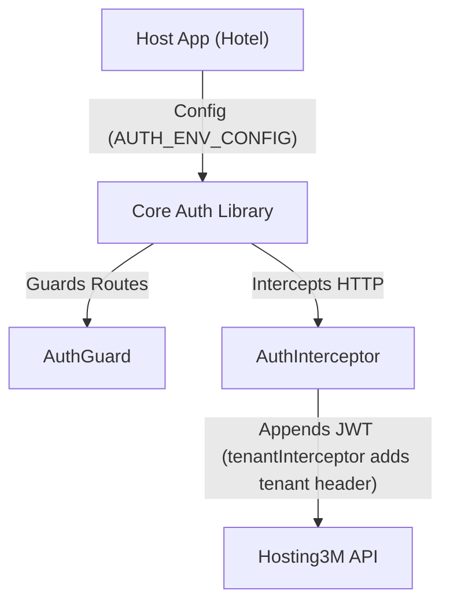

# 🏛️ Architecture Overview: Core Auth Library

## 📝 Descripción
**Project:** Core Auth (Shared Angular Library)  
**Type:** Angular Library (Standalone)  
**Version:** v0.0.2[cite: 26]  
**Stack:** Angular 21[cite: 26] | HTTP Interceptors | Route Guards  
**Consumers:** `dashboard` (Hotel), `agro-erp`, `ui-chat`; `pista-hielo` (legacy)

**Core Auth** es una librería transversal diseñada para unificar la autenticación y la resolución de contexto multi-empresa (Tenant). Su responsabilidad principal es interceptar peticiones, inyectar credenciales y bloquear rutas no autorizadas.

## 1. High-Level Design
La librería utiliza el `InjectionToken` `AUTH_ENV_CONFIG` para recibir las URLs de la API desde la aplicación host (`apiUrl_crud`, `apiUrl_token`, `apiUrl_ai`, `system_id` y, opcionalmente, `apiUrl_upload`)[cite: 29]. El `authInterceptor`[cite: 27] adjunta el JWT (`Authorization: Bearer`) solo a las peticiones cuya URL empieza por `apiUrl_crud`, `apiUrl_ai` o `apiUrl_upload`. El `tenantInterceptor` (`interceptors/tenant.interceptor.ts`) adjunta el `id_company` activo como cabecera `X-Tenant-ID` (y `x-tenant-id`) a toda petición cuando hay tenant activo; un host debe registrarlo explícitamente (hoy lo hace `agro-erp`).

> **Known deviation (#1037):** ninguno de los dos interceptores es fail-closed. Sin token o sin tenant activo, la petición sale sin modificar. Ver [`README.md`](README.md#multi-tenant-behavior).



### Principios de Diseño:

1. **Multi-Tenant First:** Toda sesión está amarrada a un `CompanyContext` (`id_company`, `company_name`, `role`).


2. **Environment Agnostic:** Definición estructurada mediante la interfaz `AuthEnvironmentConfig` garantizando que la librería nunca posea variables de entorno fijas.


## 2. Library Structure

```text
projects/core-auth/src/lib/
├── auth.config.ts        # Interfaces (CompanyContext, AuthEnvironmentConfig) y token AUTH_ENV_CONFIG[cite: 29]
├── core-auth.ts          # Componente placeholder `CoreAuth` generado por el scaffold
├── auth/
│   ├── auth.guard.ts     # authGuard y roleGuard(roles)[cite: 27]
│   └── auth.interceptor.ts # authInterceptor: header Authorization[cite: 27]
├── interceptors/
│   └── tenant.interceptor.ts # tenantInterceptor: header X-Tenant-ID
└── services/
    ├── auth.service.ts   # Manejo de JWT y Login[cite: 27]
    ├── logger.service.ts # Logger interno (no exportado en public-api)
    └── tenant.service.ts # Lógica de multiempresa (TenantContext)[cite: 27]

projects/core-auth/src/public-api.ts  # Punto de entrada (Barrel file)

```

> No existe `TenantSelectorComponent` en esta librería ni se exporta desde `public-api.ts`; solo `agro-erp` define el suyo.

## 3. Data Flow

1. **Login:** El `AuthService` autentica al usuario usando la `apiUrl_token`.


2. **Tenant Resolution:** El `TenantService` no consulta la API: el host le entrega el arreglo con `setAvailableTenants()` y fija el contexto activo con `setActiveTenant()`; ambos se guardan en `localStorage` y `hydrate()` los restaura. `TenantContext` es una interfaz propia de `tenant.service.ts` que repite `id_company`, `company_name` y `role` de `CompanyContext` y añade `industry` y `business_type`.


3. **Execution:** El `authInterceptor` adjunta el JWT y el `tenantInterceptor` adjunta el `id_company` activo como cabecera (ver Known deviation #1037 arriba).


## 📦 Authors

**Francisco Jesus Pérez Pimienta**
*Senior Systems Architect & Project Lead*
Hosting3M Automation Suite

---

*Built with the assistance of AI-powered development tools.*
