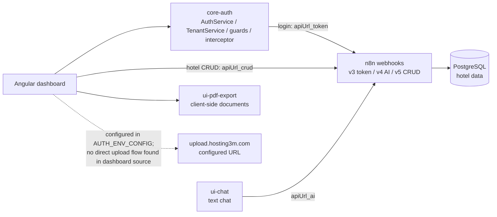

# 🏛️ Architecture Overview: AdminHotel Dashboard

## Project baseline

**Version:** v0.11.0 ([CHANGELOG](./CHANGELOG.md))
**Stack:** Angular 21 standalone components and Signals | `core-auth`, `ui-chat`, `ui-pdf-export` | n8n CRUD/AI webhooks | PostgreSQL behind n8n

AdminHotel is the hotel operations SPA in the Hosting3M monorepo. Its feature folders separate administration, booking, dashboard operations and finance. Child routes are registered with direct component references in `app.routes.ts`; the current routing is **not lazy-loaded**.

## 1. Application structure

```text
src/app/
├── core/                 # auth interceptor, interfaces, hotel types, theme
├── features/
│   ├── admin/            # login, guests, users, assets and admin services
│   ├── booking/          # reservations, check-in/out, room detail and booking service
│   ├── dashboard/        # room rack, maintenance and hotel services
│   └── finance/          # expenses, daily reports and report services
├── shared/               # layout, sidebar, loaders, placeholders and utilities
├── app.config.ts         # router, HTTP interceptor, shared-library configuration
├── app.routes.ts
└── app.component.*       # root shell; includes the shared AI chat
```

### Routes and access guards

| Route | Feature | Guard in route config |
|---|---|---|
| `/login` | Admin login | None |
| `/dashboard` | Room rack | `authGuard` on parent layout |
| `/dashboard/mantenimiento` | Maintenance monitor | Parent `authGuard` |
| `/dashboard/reservas` | Reservation manager | Parent `authGuard` |
| `/dashboard/huespedes` | Guest list | Parent `authGuard` |
| `/dashboard/personal` | User list | Parent `authGuard` and `roleGuard(['ADMIN'])` |
| `/dashboard/inventario` | Asset inventory | Parent `authGuard` and `roleGuard(['ADMIN'])` |
| `/dashboard/finanzas` | Daily finance report | Parent `authGuard` and `roleGuard(['ADMIN'])` |
| `/unauthorized` | Unauthorized view | None |

Unknown routes redirect to `/login`. `MainLayoutComponent` hosts the child router outlet and responsive sidebar.

## 2. Room operations and property infrastructure

`BookingService` reads `hotel_rooms` through the CRUD gateway, sorts rooms by room number and groups them for the room rack. The operational Hotel San José inventory is **18 rooms**, but that count is not a frontend constant or maximum: the dashboard renders the room rows returned by the backend.

The UI groups `SENCILLA`, `KING` (Kingsize), `DOBLE` and `TRIPLE`; the service also recognizes `INDIVIDUAL` and displays other backend types as fallback groups. Operational state includes available, occupied and maintenance room states, cleaning state, reservations and pending maintenance tickets.

`AssetService` manages `hotel_assets` as physical inventory, including category, condition, purchase data and location in a room or the warehouse. The implemented category choices are electronics, furniture, linens, decoration and other. The inspected source has **no sub-meter readings, electricity-consumption telemetry or energy-monitoring integration**; inventorying an electrical asset does not provide those functions.

## 3. Backend, identity and tenant context



- **Authentication:** the login delegates to `AuthService` from `core-auth`; `TenantService` stores the selected company context. `authGuard`, `roleGuard` and `authInterceptor` are provided by the shared library. The interceptor adds the stored token only to requests whose origin exactly matches one of the origins in `AUTH_ENV_CONFIG` (#1037).
- **CRUD and persistence:** dashboard services call the configured n8n `crud/v5` endpoint over HTTP; the browser does not connect directly to PostgreSQL. The services access models including `hotel_rooms`, `hotel_bookings`, `hotel_guests`, `hotel_room_inspections`, `hotel_maintenance_tickets`, `hotel_assets`, `hotel_expenses`, `users` and `companys`.
- **Tenant context:** booking and expense operations include `id_company` from `TenantService` in relevant requests. This client-side context is not itself a security boundary. The hotel uses `v5/CRUD`; its tenant header/filter behavior does not enforce company membership or guarantee row isolation. Do not treat PostgreSQL RLS as protection for this gateway.
- **Shared chat:** `AiChatComponent` is included at the application root and configured with `apiUrl_ai`. The dashboard does not set `attachments.enabled`, so UI Chat attachment support is not enabled here.
- **Documents and uploads:** the finance report imports the shared `ui-pdf-export` library for client-side PDF output. `apiUrl_upload` is configured for `core-auth`, but no dashboard component/service upload flow was found in the inspected source.
- **Payments:** booking and finance records carry payment amounts, statuses and methods for hotel operations/reporting. No external payment processor or payment-gateway integration was found in the dashboard source.

## 4. Feature services and data responsibilities

| Area | Main services | Data and responsibilities |
|---|---|---|
| Room rack / operations | `BookingService`, `HotelService`, `MaintenanceService` | Room inventory, booking-derived state, cleaning checklists and maintenance tickets |
| Booking | `BookingService`, `AdminService` | Reservations, check-in/out, date conflicts and payment allocations |
| Administration | `AdminService`, `AssetService` | Guests, hotel assets and user administration |
| Finance | `ExpenseService`, `ReportService` | `hotel_expenses`, booking income, date/payment filters, balances and report export |

The v0.11.0 changelog describes booking/payment workflows including pending quotes, confirmation after a payment, group payment allocation, and recalculation for extended stays. These are hotel booking/accounting workflows, not evidence of an external payment gateway.

## 5. Deployment and known integration constraints

- Both dashboard environment configurations point to the production n8n host; local development requests can therefore reach production services/data. Use care when running the app locally.
- In the current suite configuration, `users` is blocked in `v5/CRUD` by design. Although `/dashboard/personal` remains in the route table, its user-management backend is unavailable until the hotel is migrated to the secured `v6/CRUD`.
- The `v5/CRUD` gateway is restricted to hotel models, but the restriction does not provide per-company membership isolation for the allowed hotel models. The hotel migration to `v6/CRUD` remains an active suite-level security task.

## Authors

**Francisco Jesus Pérez Pimienta**
Senior Systems Architect & Project Lead
Hosting3M Automation Suite