# Git-based deploy of hosting3m-site (CI-built artifact branches)

Replaces the manual `rsync` release of `docs/phase-4/cutover-runbook.md` (sections 1 and 2). That runbook stays valid for everything else
(Cloudflare, headers, redirects, SEO, smoke tests); its rsync steps are marked superseded **once this flow has been proven on beta and on production**.

Status: **designed and implemented in the repo; not yet applied on the server.** The server setup (section 2) and the first beta run are still to do by hand.
This file only documents the procedure: it does not run anything against the VPS, Plesk or Cloudflare. Placeholders: `<SUBSCRIPTION_USER>`,
`<ARTIFACT_DIR_BETA>`, `<ARTIFACT_DIR_PROD>`, `<SERVER_BIN>`. Never paste a token in a chat or a file.

Related: `deploy-site.sh` (server script template, this folder), `scripts/package-artifact.sh`, `.github/workflows/hosting3m-site-artifact.yml`,
`docs/phase-4/cutover-runbook.md`, `docs/changes/2026-11-27_hosting3m-site-rebuild-and-launch.md`.

---

## 1. How it works

```mermaid
flowchart LR
  D["push to develop"] --> CI
  M["push to main"] --> CI
  subgraph CI["GitHub Actions (hosting3m-site-artifact.yml)"]
    T["tests + both guards"] --> B["build (beta or production)"] --> P["SHA256SUMS + BUILD_INFO"]
  end
  P -->|"develop: beta config"| XB["branch deploy/beta (orphan, force-pushed by CI)"]
  P -->|"main: production config + legal guard"| XP["branch deploy/prod (orphan, force-pushed by CI)"]
  XB -->|"owner pulls in the panel (manual mode)"| SB["panel checkout dir, beta"]
  XP -->|"owner pulls in the panel (manual mode)"| SP["panel checkout dir, prod"]
  SB -->|"post-deploy: one line calls the root-owned script"| S1["deploy-site.sh beta"]
  SP -->|"post-deploy: one line calls the root-owned script"| S2["deploy-site.sh prod"]
  S1 --> R1["verify, backup, rsync (no --delete)"] --> DB["beta docroot"]
  S2 --> R2["verify, backup, rsync (no --delete)"] --> DP["production docroot"]
```



- **CI** (`.github/workflows/hosting3m-site-artifact.yml`) runs only on `push` to `develop` and `main` (never on `pull_request` or forks), and only when site files,
  the workspace dependency files or the workflow itself change. A `build` job with read-only permissions runs `npm ci`, the unit tests, the guard tests and the official
  build (`scripts/build.mjs`, which runs the TODO guard and the legal-markers guard); a separate `publish` job (the only one with `contents: write`) verifies the
  artifact and force-pushes it.
- **The artifact branch** is an orphan, single-commit branch updated only by CI. It never carries source. Its root holds the built files, `SHA256SUMS` (sha256 of every
  other file) and `BUILD_INFO` (`source_commit`, `source_ref`, `config`, `built_at_utc`, `plans_snapshot_sha256`). No secrets.
- **Configuration per branch:** `develop` -> `deploy/beta` (beta configuration; guards only warn; noindex stays a server header). `main` -> `deploy/prod`
  (production configuration; a pending `TODO_` token or legal review marker fails the build, so nothing is published).
- **Plans catalog in CI:** CI does **not** fetch the live catalog (`PLANS_SKIP_FETCH=1`); it builds from the committed `plans-snapshot.json` and fails if the build would change it.
  Refreshing the snapshot stays a reviewed commit (cutover runbook section 6). Reason: the artifact is reproducible from a commit, a catalog outage cannot change a release,
  and prices are never published unreviewed. The consequence is that the snapshot must be refreshed and merged **before** the release that should carry new prices.
- **The panel** (Plesk Git, remote repository, **manual** mode) pulls the artifact branch into a staging directory outside the docroot. Its post-deploy action is one
  line that calls a root-owned script installed on the server; it never runs code from the repo. The script runs as the subscription user.
- **The script** (`deploy-site.sh beta|prod [--apply]`) verifies the pulled artifact against `SHA256SUMS` before touching anything, refuses any docroot other than the two
  allowlisted ones, is a dry run unless `--apply` is given, takes a tar backup first, copies with `rsync -a` **without `--delete`** (excluding `/webcard` and `/g`, and
  never copying `.git`), re-checks the docroot against the manifest and prints the rollback command. It never deletes old backups.

---

## 2. One-time server setup (by hand, once)

Hard rules: do the beta site first; copy before changing; never `--delete`; never touch `/webcard` or `/g`.

### 2.1 Install the script root-owned **[servidor]**
1. Copy `docs/deploy/deploy-site.sh` from the commit you trust to a temporary file and edit only the two `SRC_*` variables and, if needed, `BACKUP_ROOT` at the top:
   `SRC_BETA` = the panel checkout directory for `deploy/beta` (section 2.2), `SRC_PROD` = the one for `deploy/prod`. Leave the two `readonly DOCROOT_*` lines as they are
   (`/var/www/vhosts/hosting3m.com/beta.hosting3m.com/` and `/var/www/vhosts/hosting3m.com/httpdocs/`; confirm both in Plesk > Hosting Settings > Document root).
   `BACKUP_ROOT` defaults to a directory in the subscription user's home, outside both docroots.
2. Install it owned by root, not writable by the subscription user, outside any docroot and outside the user's home:
   ```sh
   sudo install -o root -g root -m 0755 ./deploy-site.edited.sh <SERVER_BIN>/hosting3m-deploy-site
   ls -l <SERVER_BIN>/hosting3m-deploy-site        # owner root, mode -rwxr-xr-x
   sha256sum <SERVER_BIN>/hosting3m-deploy-site    # write the hash down next to the repo commit it came from
   ```
3. Check that the subscription user cannot change it (expect "Permission denied"): `sudo -u <SUBSCRIPTION_USER> sh -c 'echo x >> <SERVER_BIN>/hosting3m-deploy-site'`.
4. Tools the script needs: `bash`, `rsync`, `tar`, `sha256sum`, `flock`, `realpath` (GNU coreutils and util-linux).
5. Updating the script later is the same procedure (a reviewed commit, edit the two variables, install, record the hash). The repo copy is a template, never the live file.

### 2.2 Configure the panel's Git repository, one per site **[laptop]** (Plesk)
Plesk > Websites & Domains > the domain (production) or the beta subdomain > **Git** > add a **remote repository**:
- Repository URL: the public HTTPS URL of this repository (no key is needed; do not store credentials).
- Branch: `deploy/prod` for `hosting3m.com`, `deploy/beta` for `beta.hosting3m.com`.
- **Deployment mode: Manual** (do not use automatic).
- **Deployment path: a staging directory outside the docroot** (this is the `<ARTIFACT_DIR_*>` that goes into `SRC_BETA` / `SRC_PROD`), **never the docroot itself**: if the panel
  deployed straight into the docroot it would bypass every check in the script.
- **Additional deploy actions** (post-deploy): exactly one line (the only content of the action):
  - beta: `<SERVER_BIN>/hosting3m-deploy-site beta --apply`
  - production: `<SERVER_BIN>/hosting3m-deploy-site prod`   (dry run only; the real copy is done in section 3 step 5 over SSH with `--apply`)

  Recommendation: beta applies on pull (it is private and noindex); production only verifies and lists the plan, and the owner applies it deliberately. Whether production should
  also apply on pull is the owner's decision; either way the panel stays in manual mode, so nothing happens without a click.
- To verify on the first pull (not verifiable from the repo, panel versions differ): that the panel accepts the force-updated orphan branch (a non-fast-forward update) and leaves
  the staging directory equal to the branch. If it refuses, or leaves stale files from an earlier artifact, the script stops with "files in the pulled artifact differ from SHA256SUMS":
  the staging directory is only a disposable copy, so empty it (or re-create the panel repository) and pull again. Do not work around it inside the docroot.

### 2.3 Confirm nothing deploys by itself
After saving, make sure the repository shows mode **Manual** and no webhook or "auto-deploy" option is on. Nothing in this flow needs a webhook.

---

## 3. Release steps: beta first, then production

1. **Merge to `develop`.** CI publishes `deploy/beta`. Open the run in GitHub Actions: all steps green; the log prints `BUILD_INFO`. `git ls-remote origin deploy/beta` shows the new commit.
2. **Beta pull [laptop]:** Plesk > beta subdomain > Git > **Pull updates**. The post-deploy action runs the script; read its output in the panel log (it prints the verified file count,
   the commit, the backup path, the rollback command and the list of backups). Or run it by hand over SSH as the subscription user: `<SERVER_BIN>/hosting3m-deploy-site beta` (dry run), then
   `... beta --apply`.
3. **Verify beta** (section 4) and run the beta smoke tests of `docs/phase-3/beta-runbook.md` section 8 on that commit (including the `PRUEBA BETA` form convention; never DELETE rows, mark them `status='test'`).
4. **Release PR `develop` -> `main`** only after step 3 passes and (if the release must carry new prices) after the refreshed plans snapshot is already in `develop`.
   Follow the suite's rules in the root `CLAUDE.md`; nothing else is deployed by this merge because `main` of this site does not deploy by itself.
5. **After the merge, CI publishes `deploy/prod`** (production configuration). Check the run is green: a failed legal or `TODO_` guard fails the run and `deploy/prod` stays on the previous release.
   Then, in a maintenance window inside support hours (cutover runbook gate 8):
   - Production pull **[laptop]**: Plesk > hosting3m.com > Git > **Pull updates** (runs the dry run and prints the verified artifact).
   - Read the dry-run list: only site files. Any line for `webcard/` or `g/` means something is wrong: stop.
   - Apply **[servidor]** as the subscription user: `<SERVER_BIN>/hosting3m-deploy-site prod --apply`. Note the backup path it prints.
6. **Verify production** (section 4), purge the CDN for the changed unhashed URLs, and keep the 48-hour watch list of cutover runbook section 9.

The Cloudflare/nginx directives, redirects, CORS, Turnstile hostnames and Search Console steps are not part of this flow: they stay in the cutover runbook.

---

## 4. Verification

**Hashes.** The script already checks the artifact against `SHA256SUMS` before copying and checks the docroot against it afterwards (including `index.html`). To compare from outside:
```sh
# [laptop] what the artifact says
git ls-remote origin deploy/prod                      # the artifact branch commit
# [servidor] what the docroot holds (BUILD_INFO is copied with the site)
cat /var/www/vhosts/hosting3m.com/httpdocs/BUILD_INFO  # source_commit and built_at_utc must be the release you intended
cd /var/www/vhosts/hosting3m.com/httpdocs && sha256sum -c --quiet <ARTIFACT_DIR_PROD>/SHA256SUMS && echo "docroot matches the manifest"
```
`BUILD_INFO` and `SHA256SUMS` are served with the site (so the live commit can be read from `https://hosting3m.com/BUILD_INFO`); they contain only the commit, the date and file hashes.
Hashes of `index.html` fetched over the CDN can differ if Cloudflare rewrites content: keep Auto Minify and Rocket Loader off (cutover runbook 3.2).

**Smoke tests.** Cutover runbook sections 3.4, 4.3, 4.4, 7 and 8 (pages, redirects, sitemap, consent, form, headers). At minimum after every release: `/`, `/portfolio`,
`/fjpimienta`, the four legal URLs, `/no-existe` (404), `/webcard/` unchanged, `x-robots-tag` absent on production and present on beta, and `curl -sI https://hosting3m.com/ | grep -i content-security`.

**Targeted CDN purge.** Purge by URL, not everything: `/`, `/favicon.ico`, `/favicon-32.png`, `/favicon-48.png`, `/apple-touch-icon.png`, `/sitemap.xml`, `/robots.txt`,
`/BUILD_INFO`, `/SHA256SUMS`, `/images/og-image.jpg` and the page URLs. Hashed `chunk-*.js`, `main-*.js` and `styles-*.css` change name with their content and need no purge.
If a font or image under `/fonts` or `/images` changed, purge it too (stable names, see cutover runbook 3.6). Keep the API token in an environment variable, never in a file or a chat.

---

## 5. Rollback

Every rollback restores from a backup; none deletes anything.

1. Use the command the script printed after `--apply` (it prints it again on any failure):
   ```sh
   tar -tzf <BACKUP_ROOT>/prod-<STAMP>.tar.gz | head                                  # read it first
   tar -C /var/www/vhosts/hosting3m.com/httpdocs -xzf <BACKUP_ROOT>/prod-<STAMP>.tar.gz
   ```
   (beta: `beta-<STAMP>.tar.gz` and the beta docroot). Extracting writes the old versions over the new ones; files that did not exist before the release (new hashed chunks) stay in place and are
   harmless because the restored `index.html` does not reference them. Removing them is a separate, deliberate step with its own backup.
2. Purge the CDN for the unhashed URLs of section 4 and repeat the first smoke checks.
3. If the problem is in the release itself, fix forward in `develop`, or revert the PR and let CI publish the previous content to the artifact branch (a new orphan commit; the artifact branch has no history to go back to).
4. nginx directives and Cloudflare settings are rolled back as in cutover runbook sections 2.4 and 8.2.

Backups are never deleted by the script. List them with `ls -lh <BACKUP_ROOT>`; remove old ones by hand, keeping at least the last few releases.

---

## 6. What NOT to do

- Do not let the panel deploy into a docroot, and do not turn on automatic mode or a webhook for these repositories.
- Do not write to `deploy/beta` or `deploy/prod` by hand, and never put source, secrets or the `.env` of anything on them. CI force-pushes them; any manual commit is lost on the next run.
- Do not edit the installed script in place or make it writable by the subscription user; do not call anything from the pulled directory in the post-deploy action.
- Do not add `--delete` to the `rsync`, and do not touch `/webcard` or `/g`.
- Do not skip the dry run before the first `--apply` of a release, and do not apply without the printed backup path written down.
- Do not copy the beta artifact into production: the script refuses it (`BUILD_INFO` `config` must be `production` for `prod`), but check anyway.
- Do not run a production build by hand to "fix" the artifact; fix the cause in `develop` and let CI publish.
- Do not pull an artifact whose CI run was red, and do not pull while another deployment is running (the script holds a lock and refuses).
- Do not paste tokens, webhook IDs, API URLs with secrets, internal IPs or server paths with secrets into the repo, the PR or a chat.

---

## 7. The other sites that use the panel's Git today (reference, not changed by this work)

Three sites are deployed through the same panel feature but with a different model. This is how they work today, as reported by the owner (only the traits listed here were reported; the rest is marked as inferred); **the deploy actions live only in
the panel UI** (no copy in the repo), so the descriptions below are summaries of the steps, not the action text, and per-site details should be re-read from the panel before relying on them.

| Site (panel) | Project in the repo | Branch and mode | What the post-deploy action does (summary) |
|---|---|---|---|
| `sanjose` | `hotel-website` | `main`, automatic | Runs on the VPS: removes the contents of the document root without a backup, then builds the Angular app there (`npm install`) and puts the build output in the document root. |
| `agroerp` | `agro-erp` (inferred from the name; confirm) | `main`, automatic | Runs on the VPS: builds the Angular app there (`npm install`) and publishes the result to the site's document root (exact publish step: read it in the panel). |
| `admin.sanjose` | `dashboard` (inferred from the name; confirm) | `main`, automatic | Runs on the VPS: builds the Angular app there (`npm install`) and publishes the result to the site's document root (exact publish step: read it in the panel). |

Common traits: the panel pulls `main` automatically and the **build runs on the VPS**; the three actions are separate, so a merge to `main` triggers all of them at once (and `hosting3m-site`
is not part of that, because its `main` is only built by CI and deployed by hand through this runbook). The environment files these builds need are not in the repo and are not described here.

Backlog (documented, **not changed here**):
- The hotel action deletes the document-root contents before copying and takes no backup: a failure after the delete can leave the public site empty.
- Builds run on the VPS with `npm install` (not `npm ci`): not reproducible, uses VPS CPU/RAM, and depends on the registry at deploy time.
- Any merge to `main` triggers all three actions, even when the change touches only one of the projects.
- `admin.pistahielo` still auto-deploys although `pista-hielo` is legacy and out of production (root `CLAUDE.md`): decide whether to disconnect it.
- The actions are not versioned: record them in a runbook (with placeholders instead of environment values) or move them to server-side scripts like this one.
