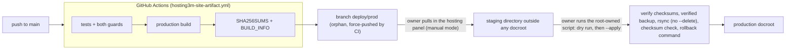

# Git-based deploy of hosting3m-site (CI-built artifact branches)

Replaces the manual `rsync` release of `docs/phase-4/cutover-runbook.md` (sections 1 and 2). That runbook stays valid for everything else
(Cloudflare, headers, redirects, SEO, smoke tests); its rsync steps are superseded by this flow, which has been used for production releases (see section 8).

Status: **in use for production** (reported by owner, see section 8). There is **no beta environment**: the beta subdomain, docroot and panel repository were deleted by the owner on 2026-11-27
(reported by owner); section 9 says what to create to bring one back.
This file only documents the procedure: it does not run anything against the VPS, Plesk or Cloudflare. Placeholders: `<SUBSCRIPTION_USER>`,
`<ARTIFACT_DIR_PROD>`, `<SERVER_BIN>`. Never paste a token in a chat or a file.

Related: `deploy-site.sh` (server script template, this folder), `scripts/package-artifact.sh`, `.github/workflows/hosting3m-site-artifact.yml`,
`docs/phase-4/cutover-runbook.md`, `docs/changes/2026-11-27_hosting3m-site-rebuild-and-launch.md`.

---

## 1. How it works



- **CI**```

- **CI** (`.github/workflows/hosting3m-site-artifact.yml`) runs only on `push` to `main` (never on `pull_request` or forks), and only when site files,
  the workspace dependency files or the workflow itself change. A `build` job with read-only permissions runs `npm ci`, the unit tests, the guard tests and the official
  build (`scripts/build.mjs`, which runs the TODO guard and the legal-markers guard); a separate `publish` job (the only one with `contents: write`) verifies the
  artifact and force-pushes it.
- **The artifact branch** is an orphan, single-commit branch updated only by CI. It never carries source. Its root holds the built files, `SHA256SUMS` (sha256 of every
  other file) and `BUILD_INFO` (`source_commit`, `source_ref`, `config`, `built_at_utc`, `plans_snapshot_sha256`). No secrets.
- **Configuration:** `main` -> `deploy/prod` (production configuration; a pending `TODO_` token or legal review marker fails the build, so nothing is published).
- **Plans catalog in CI:** CI does **not** fetch the live catalog (`PLANS_SKIP_FETCH=1`); it builds from the committed `plans-snapshot.json` and fails if the build would change it.
  Refreshing the snapshot stays a reviewed commit (cutover runbook section 6). Reason: the artifact is reproducible from a commit, a catalog outage cannot change a release,
  and prices are never published unreviewed. The consequence is that the snapshot must be refreshed and merged **before** the release that should carry new prices.
- **The panel** (Plesk Git, remote repository, **manual** mode) pulls the artifact branch into a staging directory outside both docroots. The owner then runs a
  root-owned script installed on the server (never code from the repo) as the subscription user. A panel post-deploy action is optional; today there is none (section 8).
- **The script** (`deploy-site.sh prod [--apply]`) verifies the pulled artifact against `SHA256SUMS` before touching anything, refuses any docroot other than the
  allowlisted production one, is a dry run unless `--apply` is given, takes a tar backup first, copies with `rsync -a` **without `--delete`** (excluding `/webcard` and `/g`, and
  never copying `.git`), re-checks the docroot against the manifest and prints the rollback command. It never deletes old backups.

---

## 2. One-time server setup (by hand, once)

Hard rules: copy before changing; never `--delete`; never touch `/webcard` or `/g`.

### 2.1 Install the script root-owned **[servidor]**
1. Copy `docs/deploy/deploy-site.sh` from the commit you trust to a temporary file and edit only `SRC_PROD` and `BACKUP_ROOT` at the top:
   `SRC_PROD` = the panel checkout directory for `deploy/prod` (section 2.2). Leave the `readonly DOCROOT_PROD` line as it is
   (`/var/www/vhosts/hosting3m.com/httpdocs/`; confirm it in Plesk > Hosting Settings > Document root).
2. Set `BACKUP_ROOT` to an **absolute path** (a folder the subscription user can write, outside the docroot, for example `/var/www/vhosts/hosting3m.com/deploy-backups/hosting3m-site`);
   it deliberately does not default to `$HOME`. `--apply` refuses while it still holds the `/CHANGE/ME/` placeholder or is not absolute; a dry run does not need it.
3. Install it owned by root, not writable by the subscription user, outside any docroot and outside the user's home:
   ```sh
   sudo install -o root -g root -m 0755 ./deploy-site.edited.sh <SERVER_BIN>/hosting3m-deploy-site
   ls -l <SERVER_BIN>/hosting3m-deploy-site        # owner root, mode -rwxr-xr-x
   sha256sum <SERVER_BIN>/hosting3m-deploy-site    # write the hash down next to the repo commit it came from
   ```
4. Check that the subscription user cannot change it (expect "Permission denied"): `sudo -u <SUBSCRIPTION_USER> sh -c 'echo x >> <SERVER_BIN>/hosting3m-deploy-site'`.
5. Tools the script needs: `bash`, `rsync`, `tar`, `sha256sum`, `flock`, `realpath` (GNU coreutils and util-linux).
6. Updating the script later is the same procedure (a reviewed commit, edit the two variables, install, record the hash). The repo copy is a template, never the live file.

### 2.2 Configure the panel's Git repository **[laptop]** (Plesk)
Plesk > Websites & Domains > the production domain > **Git** > add a **remote repository**:
- Repository URL: the public HTTPS URL of this repository (no key is needed; do not store credentials).
- Branch: `deploy/prod`.
- **Deployment mode: Manual** (do not use automatic).
- **Deployment path: a staging directory outside any docroot** (this is the `<ARTIFACT_DIR_PROD>` that goes into `SRC_PROD`). A staging folder under `httpdocs` would be published or read
  as part of the site. Use a folder under the subscription's git-work area (for example `/var/www/vhosts/hosting3m.com/git-work/hosting3m-site-prod`; confirm the real location in the panel),
  never under `httpdocs`. If the panel deployed straight into the docroot it would bypass every check in the script, and the script refuses a staging directory that is
  inside, equal to, or a parent of the docroot.
- **Additional deploy actions** (post-deploy): none is needed. The owner runs `<SERVER_BIN>/hosting3m-deploy-site prod` (dry run) and then `... prod --apply` by hand (section 3).
  If a one-line action is added later, it must only call that root-owned script as a dry run; the real copy stays a deliberate `--apply`.
- To verify on the first pull (not verifiable from the repo, panel versions differ): that the panel accepts the force-updated orphan branch (a non-fast-forward update) and leaves
  the staging directory equal to the branch. If it refuses, or leaves stale files from an earlier artifact, the script stops with "files in the pulled artifact differ from SHA256SUMS":
  the staging directory is only a disposable copy, so empty it (or re-create the panel repository) and pull again. Do not work around it inside the docroot.

### 2.3 Confirm nothing deploys by itself
After saving, make sure the repository shows mode **Manual** and no webhook or "auto-deploy" option is on. Nothing in this flow needs a webhook.

---

## 3. Release steps

1. **Merge to `main`.** CI builds the production artifact and publishes `deploy/prod`. Open the run in GitHub Actions: all steps green (the build and the site tests run there); the log prints
   `BUILD_INFO`. A failed legal or `TODO_` guard fails the run and `deploy/prod` stays on the previous release. If the release must carry new prices, the refreshed plans snapshot has to be
   merged before. `git ls-remote origin deploy/prod` shows the new commit.
2. **Pull [laptop]:** Plesk > the production domain > Git > **Pull updates**.
3. **Dry run [servidor]**, inside a maintenance window within support hours (cutover runbook gate 8), as the subscription user: `<SERVER_BIN>/hosting3m-deploy-site prod`. It verifies the
   artifact against `SHA256SUMS` and lists what would change. Read the list: only site files; any line for `webcard/` or `g/` means something is wrong: stop.
4. **Apply [servidor]:** `<SERVER_BIN>/hosting3m-deploy-site prod --apply`. It takes a verified backup first, copies, checks the docroot against the manifest and prints the rollback command
   and the list of backups. Note the backup path.
5. **Verify** (section 4), purge the CDN for the changed unhashed URLs, and keep the 48-hour watch list of cutover runbook section 9.

The Cloudflare/nginx directives, redirects, CORS, Turnstile hostnames and Search Console steps are not part of this flow: they stay in the cutover runbook.

---

## 4. Verification

**Hashes.** The script already checks the artifact against `SHA256SUMS` before copying and checks the docroot against it afterwards (including `index.html`). To compare from outside:
```sh
# [laptop] what the artifact says
git ls-remote origin deploy/prod                      # the artifact branch commit
# [servidor] what the docroot holds (BUILD_INFO is copied with the site)
cat /var/www/vhosts/hosting3m.com/httpdocs/BUILD_INFO  # source_commit and built_at_utc must be the release you intended
cd /var/www/vhosts/hosting3m.com/httpdocs && sha256sum -c --quiet <ARTIFACT_DIR_PROD>/SHA256SUMS && echo "docroot matches the manifest"
```
`BUILD_INFO` and `SHA256SUMS` are served with the site (so the live commit can be read from `https://hosting3m.com/BUILD_INFO`); they contain only the commit, the date and file hashes.
Hashes of `index.html` fetched over the CDN can differ if Cloudflare rewrites content: keep Auto Minify and Rocket Loader off (cutover runbook 3.2).

**Smoke tests.** Cutover runbook sections 3.4, 4.3, 4.4, 7 and 8 (pages, redirects, sitemap, consent, form, headers). At minimum after every release: `/`, `/portfolio`,
`/fjpimienta`, the four legal URLs, `/no-existe` (404), `/webcard/` unchanged, `x-robots-tag` absent on production, and `curl -sI https://hosting3m.com/ | grep -i content-security`.

**Targeted CDN purge.** Purge by URL, not everything: `/`, `/favicon.ico`, `/favicon-32.png`, `/favicon-48.png`, `/apple-touch-icon.png`, `/sitemap.xml`, `/robots.txt`,
`/BUILD_INFO`, `/SHA256SUMS`, `/images/og-image.jpg` and the page URLs. Hashed `chunk-*.js`, `main-*.js` and `styles-*.css` change name with their content and need no purge.
If a font or image under `/fonts` or `/images` changed, purge it too (stable names, see cutover runbook 3.6). Keep the API token in an environment variable, never in a file or a chat.

---

## 5. Rollback

Every rollback restores from a backup; none deletes anything.

1. Use the command the script printed after `--apply` (it prints it again on any failure):
   ```sh
   tar -tzf <BACKUP_ROOT>/prod-<STAMP>.tar.gz | head                                  # read it first
   tar -C /var/www/vhosts/hosting3m.com/httpdocs -xzf <BACKUP_ROOT>/prod-<STAMP>.tar.gz
   ```
   **Then check `BUILD_INFO` and `SHA256SUMS` in the docroot:** if the backup came from before this flow existed (the first
   release) it holds neither, so the extract leaves the files of the rolled-back release in place and `/BUILD_INFO` would keep reporting the wrong commit. In that case delete just
   those two files by hand (`rm <DOCROOT>/BUILD_INFO <DOCROOT>/SHA256SUMS`, nothing else); if the backup does contain them, the extract has already restored them. Extracting writes the old versions over the new ones; files that did not exist before the release (new hashed chunks) stay in place and are
   harmless because the restored `index.html` does not reference them. Removing them is a separate, deliberate step with its own backup.
2. Purge the CDN for the unhashed URLs of section 4 and repeat the first smoke checks.
3. If the problem is in the release itself, fix forward in `develop`, or revert the PR and let CI publish the previous content to the artifact branch (a new orphan commit; the artifact branch has no history to go back to).
4. nginx directives and Cloudflare settings are rolled back as in cutover runbook sections 2.4 and 8.2.

Backups are never deleted by the script. List them with `ls -lh <BACKUP_ROOT>`; remove old ones by hand, keeping at least the last few releases.

---

## 6. What NOT to do

- Do not let the panel deploy into a docroot, and do not turn on automatic mode or a webhook for these repositories.
- Do not write to `deploy/prod` by hand, and never put source, secrets or the `.env` of anything on it. CI force-pushes it; any manual commit is lost on the next run.
- Do not edit the installed script in place or make it writable by the subscription user; do not call anything from the pulled directory in the post-deploy action.
- Do not add `--delete` to the `rsync`, and do not touch `/webcard` or `/g`.
- Do not skip the dry run before the first `--apply` of a release, and do not apply without the printed backup path written down.
- Do not deploy an artifact that was not built with the production configuration: the script refuses it (`BUILD_INFO` `config` must be `production`), but check anyway.
- Do not run a production build by hand to "fix" the artifact; fix the cause in `develop` and let CI publish.
- Do not pull an artifact whose CI run was red, and do not pull while another deployment is running (the script holds a lock and refuses).
- Do not paste tokens, webhook IDs, API URLs with secrets, internal IPs or server paths with secrets into the repo, the PR or a chat.

---

## 7. The other sites that use the panel's Git today (reference, not changed by this work)

Three sites are deployed through the same panel feature but with a different model. This is how they work today, as reported by the owner (only the traits listed here were reported; the rest is marked as inferred); **the deploy actions live only in
the panel UI** (no copy in the repo), so the descriptions below are summaries of the steps, not the action text, and per-site details should be re-read from the panel before relying on them.

| Site (panel) | Project in the repo | Branch and mode | What the post-deploy action does (summary) |
|---|---|---|---|
| `sanjose` | `hotel-website` | `main`, automatic | Runs on the VPS: removes the contents of the document root without a backup, then builds the Angular app there (`npm install`) and puts the build output in the document root. |
| `agroerp` | `agro-erp` (inferred from the name; confirm) | `main`, automatic | Runs on the VPS: builds the Angular app there (`npm install`) and publishes the result to the site's document root (exact publish step: read it in the panel). |
| `admin.sanjose` | `dashboard` (inferred from the name; confirm) | `main`, automatic | Runs on the VPS: builds the Angular app there (`npm install`) and publishes the result to the site's document root (exact publish step: read it in the panel). |

Common traits: the panel pulls `main` automatically and the **build runs on the VPS**; the three actions are separate, so a merge to `main` triggers all of them at once (and `hosting3m-site`
is not part of that, because its `main` is only built by CI and deployed by hand through this runbook). The environment files these builds need are not in the repo and are not described here.

Backlog (documented, **not changed here**):
- The hotel action deletes the document-root contents before copying and takes no backup: a failure after the delete can leave the public site empty.
- Builds run on the VPS with `npm install` (not `npm ci`): not reproducible, uses VPS CPU/RAM, and depends on the registry at deploy time.
- Any merge to `main` triggers all three actions, even when the change touches only one of the projects.
- `admin.pistahielo` still auto-deploys although `pista-hielo` is legacy and out of production (root `CLAUDE.md`): decide whether to disconnect it.
- The actions are not versioned: record them in a runbook (with placeholders instead of environment values) or move them to server-side scripts like this one.

---

## 8. Production setup as deployed

Everything in this section about the server and the hosting panel is **reported by owner, not verifiable in repo**.

- **Hosting-panel git repository for this site**, in manual mode and with no post-deploy action, tracking `deploy/prod` (production host). A second repository tracked `deploy/beta` on the beta host until the
  beta environment was removed on 2026-11-27. The repository deploys into a staging directory outside any docroot. The server script then copies from the staging directory to the docroot: dry run by default, `--apply` to execute, a verified
  backup first, checksum verification after, and the rollback command printed at the end. Because the panel actions are empty, the owner runs the script by hand after each pull.
- **The other suite sites work differently:** they track `main` in automatic mode and build on the server, so merging to `main` triggers their deploys. This site does not: a merge to `main`
  only makes CI publish `deploy/prod`; nothing reaches the production docroot until the owner pulls it and runs the script (section 7 lists those sites).
- **Panel CLI notes:**
  - The `create` command ignores the active-branch option. Set the branch with `update`, then fetch and deploy.
  - The UI "Deploy now" button can hang; the CLI deploy is reliable.
  - Never paste or commit the panel's webhook URL: it triggers a deploy and must be treated as a credential.
- **First deploy:** the panel pulled the force-updated orphan branches without problems in all three deployments (two on beta before it was removed, one on production).
- **Rollback:** proven on beta before it was removed; **not exercised on production**.
- **CDN:** the CDN rewrites HTML in transit (email obfuscation), so the hash of a page fetched from the public host differs from the hash of the file in the docroot. Compare hashes
  against the origin (the manifest or the file in the docroot), not against the public response. Disabling that CDN option is optional.

---

## 9. Recreating a beta environment

There is none today (removed 2026-11-27, reported by owner). To bring one back, create all of these; nothing in the repo does it for you:
1. **A subdomain** with its own docroot (outside the production docroot) and the web-server settings that keep it out of search results.
2. **A panel git repository** for that subdomain in manual mode, tracking a deploy branch (for example `deploy/beta`), deploying into a staging directory outside any docroot.
3. **A CI job** in `.github/workflows/hosting3m-site-artifact.yml`: a trigger on the branch that should feed it, a build with the beta configuration, and a publish step to that deploy branch
   (the publish step currently accepts only `deploy/prod`).
4. **A script target** in `deploy-site.sh`: a second allowlisted docroot, its own `SRC_*` variable, a `BUILD_INFO` configuration check for it, and the matching tests; install the new script root-owned
   on the server (section 2.1). The server copy is separate from the repo template, so it must be updated by hand.
