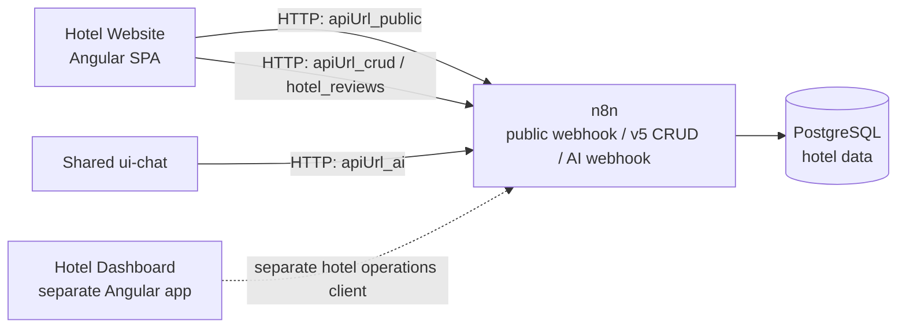

# 🏛️ Architecture Overview: Hotel Eco-Website

## 📝 Descripción

**Project:** Hotel Eco-Website (Hosting3M Automation Suite)
**Stack:** Angular 21 SPA | Tailwind CSS | shared `ui-chat` | n8n webhooks / Meta-CRUD | PostgreSQL behind n8n
**Author:** Francisco Jesus Pérez Pimienta

The public hotel SPA lives alongside the hotel dashboard and shared libraries in the Angular
workspace. The inspected application imports `ui-chat`; it does not import `core-auth` or
`ui-pdf-export`. Its online availability search currently has a preventive kill switch:
the handler shows a maintenance notice and returns before requesting availability.

## 1. 🗺️ High-Level Design (The "Big Picture")

El sistema mantiene el patrón **Data-Access Service** para el Dashboard, pero expande su alcance integrando micro-frontends (librerías) y múltiples aplicaciones que consumen el mismo motor de **n8n**.



### Principios de integración

1. **Shared monorepo:** The public website and dashboard are separate Angular applications; only dependencies actually imported by this app are listed as integrations.
2. **Backend mediation:** The browser sends HTTP requests to n8n; it does not connect directly to PostgreSQL.
3. **Booking safety:** The availability handler is currently disabled in code and does not issue its normal request to the public booking endpoint.
4. **Public UI:** Tailwind CSS provides the website presentation. `src/styles.css` also imports the Tabler CSS, Font Awesome and Tabler Icons stylesheets from CDNs (Tabler and Tabler Icons from `@latest`); dashboard routing and theming are outside this application's architecture.

### Tailwind build and deployment

The website uses Tailwind CSS v4 through `@tailwindcss/postcss`, configured in
`.postcssrc.json`. In `src/styles.css`, `@import "tailwindcss" source(none)` disables
automatic source discovery, `@config "../tailwind.config.js"` retains the existing
eco/tierra design tokens, and `@source` includes the website and `ui-chat`. A small
compatibility layer preserves the v3 default border color and `shadow-sm`.

Build from the workspace root with `npx ng build hotel-website --configuration production`.
The site is served through the Plesk Git deploy action.

The action pulls `main`, builds `ui-pdf-export` and `hotel-website` with the production
configuration, and replaces the published files only if both builds succeed. A failed
build leaves the previous site in place. Back up the currently published files before
triggering a deployment.

Automatic deployment is not active. After a release reaches `main`, trigger the action
manually in Plesk with **Deploy now**.

TODO(verify): the root `CLAUDE.md` says `main` publishes the frontends automatically through Plesk, which conflicts with this section and `README.md`; the Plesk action itself is not defined in the repository.

#### Tailwind v4 deployment troubleshooting

If a build fails, check the deploy log first. A Tailwind/PostCSS error indicates an
incorrect change to `.postcssrc.json` or `src/styles.css`; compare those files with the
Tailwind v4 configuration described above.

---

## 2. 📂 Workspace Structure (Distributed Architecture)

La aplicación ha migrado a un espacio de trabajo estructurado por proyectos.

### Aplicaciones Principales

| Proyecto | Ruta / Dominio | Responsabilidad |
| --- | --- | --- |
| **dashboard** | Separate app | Hotel operations: room rack, bookings, finance, maintenance and assets. |
| **hotel-website** | Public site | Hotel presentation, AI chat and reviews; online availability/booking search is currently disabled by the code kill switch. |

### Librerías Compartidas (Shared Libs)

| Librería | Responsabilidad | Servicios Core |
| --- | --- | --- |
| **ui-chat** | Shared conversational widget configured by the host. Used by this app. | `AiService`, `CHAT_CONFIG_TOKEN`. |
| **ui-pdf-export** | Client-side PDF generation library. Not imported by this app. | Not applicable here. |
| **core-auth** | Shared IAM library. Not imported by this app. | Not applicable here. |

---

## 3. 🧠 Service boundaries

### Finance service boundary

The finance `ReportService` belongs to the separate dashboard application and is not part
of the public website.

---

## 4. ⚙️ Current workflows and constraints

### A. Pattern: Tokenized Chat Configuration

The root application configures `ui-chat` with `CHAT_CONFIG_TOKEN`, including the AI
webhook URL and hotel branding. This host does not enable file attachments.

### B. Pattern: Availability kill switch

`searchAvailability()` currently displays a maintenance notice, clears its loading state and
returns before the public availability HTTP request. The remaining booking flow in the
component is dormant code and is not an available public booking capability.

## 5. 🗄️ Backend and data scope

The app's current HTTP paths include the public n8n API (`apiUrl_public`: `/availability` and `/lead`, both only reachable from the dormant booking flow) and hotel Meta-CRUD
(`apiUrl_crud`, `crud/v5`), used for review reads (`getall`) and submissions. The shared chat calls the
configured AI webhook (`apiUrl_ai`). These services mediate persistence in PostgreSQL.
The app registers `provideHttpClient()` without interceptors and does not import `core-auth`, so none of
these requests carries an `Authorization` header.

Known deviation (#1042): `submitForm()` (the `/lead` call) sets `formStatus` to `success` on any 2xx
response without checking the payload, so an empty HTTP 200 from a failed n8n execution is shown as success.

No `hotel_metrics` table, energy readings, CFE/water sub-meter integration, or `ui-pdf-export`
usage was found in the website source. Such items should be treated as proposals only, not as
implemented schema or features.

---

## 6. 🚀 Future Scalability

* **CRM y Eco-Metrics:** definir y validar alcance, datos y backend antes de documentar como implementados.
* **PWA Offline Mode:** evaluar soporte offline para los flujos públicos que se definan como críticos.

## 📦 Authors

**Francisco Jesus Pérez Pimienta**
*Senior Systems Architect & Project Lead*
Hosting3M Automation Suite

```
---
*Built with the assistance of AI-powered development tools.*

```