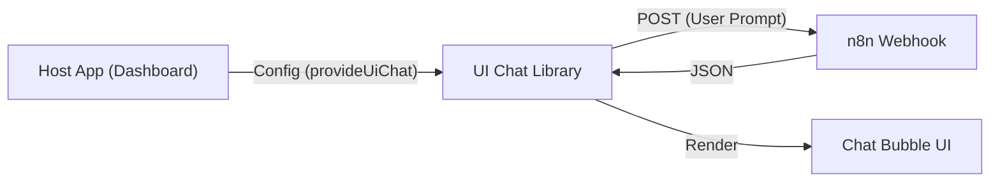

# 🏛️ Architecture Overview: UI Chat Library

## 📝 Descripción
**Project:** UI Chat (Shared Angular Library)  
**Type:** Angular Library (Standalone)  
**Version:** v0.0.1 (`package.json`)  
**Stack:** Angular 21 (Signals) | HTTP Client  
**Consumers:** `agro-erp`, `dashboard`, `hotel-website`; `pista-hielo` (legacy)

**UI Chat** es un micro-frontend encapsulado como librería, diseñado para proporcionar una interfaz de conversación ("Chat Widget") agnóstica. Su única responsabilidad es renderizar mensajes y gestionar la comunicación HTTP con el Agente de IA en n8n.

## 1. High-Level Design
La librería sigue el patrón **Smart Service / Dumb Component**. El servicio (`AiService`) gestiona la sesión y el transporte de datos; el componente muestra los mensajes y además guarda el borrador y el archivo adjunto (`userInput`, `selectedFile`, `previewUrl`, `attachmentError`). Known deviation (#1038): no hay `ChatService` y no hay streaming; cada mensaje es un `http.post` que resuelve con la respuesta completa (`output`).



### Principios de Diseño:

1. **Zero-Config Logic:** La librería maneja internamente el `sessionId` (`'web-' + crypto.randomUUID()`, generado una vez por instancia de `AiService`). Known deviation (#1038): no se persiste en `localStorage`/`sessionStorage`; una nueva instancia inicia una conversación nueva.
2. **Configurable Injection:** La configuración (`apiUrl_ai`, `logoUrl`, `title`, `primaryColor` y `attachments` opcional) se inyecta desde la aplicación padre con `provideUiChat(config)`, que registra `CHAT_CONFIG_TOKEN`, permitiendo que el mismo chat apunte a diferentes agentes sin cambiar el código. Known deviation (#1038): `primaryColor` no se lee en `src/lib`; la hoja de estilos usa `var(--primary-color, #206bc4)`.
3. **Reactive State:** Uso de **Signals** para la lista de mensajes (`messages`) y el estado de carga (`isLoading`). Known deviation (#1038): no es solo signals; `userInput` es un campo simple enlazado con `[(ngModel)]`.

---

## 2. Library Structure

```text
projects/ui-chat/src/lib/
├── components/
│   └── ai-chat/          # El Widget visual (Burbujas, Input, Scroll)
├── services/
│   └── ai.service.ts     # Cliente HTTP y Gestión de Estado (Signals); define ChatMessage
├── interfaces/
│   └── chat-config.ts    # ChatConfig y ChatAttachmentsConfig
├── tokens/
│   └── chat.token.ts     # CHAT_CONFIG_TOKEN
├── utils/
│   └── attachment.util.ts # Validación y lectura Base64 de adjuntos
├── styles/
│   └── theme.scss
└── ui-chat-modele.ts     # Archivo del scaffold: vacío (0 bytes), sin exports y sin uso

projects/ui-chat/src/public-api.ts  # Punto de entrada: exporta componente, AiService, interfaces, token y provideUiChat()

```

### Componentes Clave

* **AiChatComponent:**
* **Inputs:** ninguno. Known deviation (#1038): `isOpen` es un `signal(false)` interno y el encabezado sale de `title` en `ChatConfig`; tampoco existen outputs.
* **Features:** Auto-scroll al cambiar el historial de mensajes, envío con "Enter" (`keyup.enter`), indicador de escritura mientras `isLoading()` es verdadero, y adjunto opcional (un archivo por mensaje, desactivado por defecto).
* **Rendering:** Known deviation (#1038): el texto se interpola sin Markdown (`{{ msg.text }}`, `ai-chat.component.html:25`). Lo que no existe en el código (inputs, outputs, Markdown, `ChatService`, streaming) está en la sección "Documented but not implemented (#1038)" del README.


* **AiService (único servicio; `ai.service.ts:19`):**
* **Http Client:** Envía POST a `apiUrl_ai` (`ai.service.ts:46`, `:87`).
* **Session Handler:** Genera `'web-' + crypto.randomUUID()` y lo envía como `sessionId` en el cuerpo (no en headers) de cada request para que n8n mantenga la memoria.
* **Tenant:** Envía `tenant_id` (`TenantService.activeTenant()?.id_company` de `core-auth`) en el cuerpo. Known deviation (#1038): no hay verificación previa; si no hay tenant activo, la petición se envía sin `tenant_id`.


---

## 3. Data Flow

1. **User Input:** El usuario escribe y presiona Enviar.
2. **Optimistic Update:** La UI muestra inmediatamente el mensaje del usuario y un loader ("...").
3. **Transport:** `AiService` envía el payload `{ chatInput: "...", sessionId: "web-<uuid>", tenant_id: <id_company> }` (más `file: { name, type, size, base64 }` si hay adjunto) y lee `response.output`.
4. **Response:**
* *Éxito:* Se agrega la respuesta de texto del agente (`output`) al historial y se apaga el loader. En mensajes de texto, `sendMessage` resuelve `true` al despachar la petición, antes de la respuesta (`ai.service.ts:60`); con adjunto, resuelve al terminar (`ai.service.ts:93-94`).
* *Error:* Se agrega un mensaje del bot en español con el aviso de error (no hay toast). Con adjunto, el mensaje del usuario se retira del historial y el borrador y el archivo se conservan para reintentar; sin adjunto, el mensaje del usuario permanece.

## 📦 Authors

**Francisco Jesus Pérez Pimienta**
*Senior Systems Architect & Project Lead*
Hosting3M Automation Suite

```
---
*Built with the assistance of AI-powered development tools.*

```