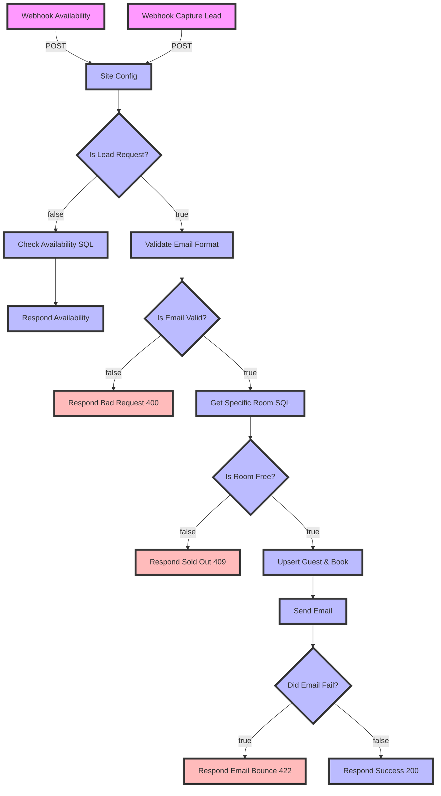

# v4/Public Booking Engine (B2C) Workflow Documentation

## 📝 Descripción
Este workflow actúa como el **Backend For Frontend (BFF)**, aislando de forma segura la base de datos de la web pública B2C. Gestiona la disponibilidad de inventario en tiempo real y el ciclo completo de captura de *leads* (pre-reservas) mediante una arquitectura tolerante a fallos, implementando la regla de negocio de *Soft Block* y *Quality Gates* para validación de correos.

## 🧜‍♂️ Diagrama de Flujo



## 🔌 Dependencias

* **Credenciales:**
* `Postgres account`: Permite las consultas de lectura para disponibilidad y la ejecución de transacciones complejas (CTE/Upserts) blindadas contra inyección SQL.
* `SMTP Account`: Autenticación para el envío asíncrono de instrucciones bancarias y confirmaciones a los huéspedes (`reservas@hosting3m.com`).


* **Nodos Externos:**
* `Webhook`: Exposición de endpoints públicos (`/public/availability` y `/public/lead`) sin JWT.
* `Postgres`: Consultas parametrizadas con `queryReplacement` de tipo **arreglo** (cada valor como texto) y CTEs (`INSERT ... ON CONFLICT`). Ver "Parámetros y tenant (v1.18.3)".
* `Set` (`Site Config`): única fuente del `id_company` del sitio.
* `EmailSend`: Orquestador de notificaciones con tolerancia a fallos activada (`continueRegularOutput`).
* `Code`: Motor Regex para *Quality Gate* sintáctico de correos.


## 📖 Diccionario de Datos

### 1. Endpoint: Check de Disponibilidad

Consulta el inventario agrupado por tipo de habitación sin exponer IDs internos ni datos confidenciales.

* **Método y Ruta:** `POST /webhook/public/availability`
* **Request Body:**

```json
{
  "checkin": "YYYY-MM-DD",
  "checkout": "YYYY-MM-DD"
}

```

* **Response (200 OK):**

```json
{
  "status": "success",
  "data": [
    {
      "type": "Kingsize",
      "available_count": "3",
      "price": "550.00"
    },
    {
      "type": "sencilla",
      "available_count": "6",
      "price": "500.00"
    }
  ]
}

```

### 2. Endpoint: Captura de Lead (Pre-Reserva)

Procesa la intención de reserva, valida el correo electrónico, asegura la disponibilidad final, inserta/actualiza al huésped, crea la reserva en estado `pending` y envía instrucciones de pago.

* **Método y Ruta:** `POST /webhook/public/lead`
* **Request Body:**

```json
{
  "name": "Francisco Jesus Perez Pimienta",
  "phone": "9930000000",
  "email": "ejemplo@correo.com",
  "checkin": "YYYY-MM-DD",
  "checkout": "YYYY-MM-DD",
  "room_type": "Kingsize",
  "guests": "2"
}

```

* **Responses:**
* **✅ 200 OK (Success):** El lead fue guardado y el correo de instrucciones enviado correctamente.
```json
{
  "status": "success",
  "message": "Lead capturado y correo enviado exitosamente.",
  "booking_id": 30
}

```


* **❌ 400 Bad Request (Invalid Email):** El *Quality Gate* detuvo el proceso por sintaxis incorrecta.
```json
{
  "status": "error",
  "message": "El formato del correo electrónico es inválido."
}

```


* **❌ 409 Conflict (Sold Out):** Otra transacción ocupó la habitación milisegundos antes (*Race Condition*).
```json
{
  "status": "error",
  "message": "No hay disponibilidad para el tipo de habitación seleccionado en estas fechas."
}

```


* **❌ 422 Unprocessable Entity (SMTP Bounce):** La BD guardó el lead, pero el servidor de correo remoto rechazó la entrega (dominio inexistente o inactivo).
```json
{
  "status": "error",
  "message": "El servidor de correo rechazó la dirección. Es probable que no exista."
}

```

## 🔒 Parámetros y tenant (v1.18.3)

* **Parámetros como arreglo, cada valor como texto.** Antes, los tres nodos SQL usaban `queryReplacement` como
  texto (`={{ a }}, {{ b }}`): n8n lo parte por comas y descarta los vacíos, así que un nombre con coma
  (`Pérez, Juan`) o un teléfono vacío recorría los parámetros. Probado en LOCAL con la versión anterior: el
  `INSERT` fallaba (`invalid input syntax for type integer: "<correo>"` o `there is no parameter $7`), la reserva
  **se perdía** y el sitio mostraba "éxito", porque la ejecución fallida responde HTTP 200 vacío. Ahora
  el `queryReplacement` es `={{ [ ... ].map(...) }}`: cada valor pasa por `String(...)` (objetos a JSON;
  `null`/`undefined` → `null`, nunca se descartan) y la consulta castea cada parámetro (`$n::text`, `::date`,
  `::int`). Mismo patrón que el Global Error Handler v1.18.2.
* **Teléfono vacío o ausente → `NULL`** (`NULLIF($2::text, '')`).
* **Tenant desde una sola configuración.** `Site Config` (nodo `Set`) define `id_company` (hoy `1`, la empresa
  que concentra los datos del hotel). Las dos rutas pasan por él y `Is Lead Request?`
  (`$('Webhook Capture Lead').isExecuted`) devuelve cada petición a su rama. Las consultas de `hotel_rooms` y
  `hotel_bookings` filtran por ese `id_company`, y el `INSERT` lo usa en `hotel_guests` y `hotel_bookings`.
* **Correo existente: no se modifica al huésped.** `ON CONFLICT (email) DO UPDATE SET email = hotel_guests.email
  RETURNING id` solo recupera el id para la reserva. Antes sobrescribía el teléfono del huésped existente con el
  que mandara cualquiera desde el endpoint público.
* **`room_type` por igualdad exacta** (`type = $3::text`). Antes era `ILIKE $3 || '%'`: `%`, `_`, un prefijo
  (`QA`) o mayúsculas distintas reservaban cualquier tipo. `hotel-website` devuelve tal cual el `type` que recibió
  de disponibilidad (`id: room.type`), así que no necesita coincidencias parciales.
* **Notas de la reserva:** `Web Lead: <huéspedes>`, el formato que ya tienen las reservas web en producción.
* **Sin cambios:** las reservas web nacen `pending` y la disponibilidad solo cuenta `confirmed`/`checked_in`
  (*soft block*): dos leads pueden pedir la misma habitación y fechas; el personal confirma una.

### Consultas de solo lectura para producción

Historial de ejecuciones (base de n8n; el *pruning* de n8n puede haber borrado las antiguas):

```sql
SELECT status, mode, count(*), min("startedAt")::date AS desde, max("startedAt")::date AS hasta
FROM execution_entity WHERE "workflowId" = 'FImcPayB8gqFlxwq' GROUP BY 1, 2 ORDER BY 1, 2;
```

Ejecuciones que no terminaron bien: fecha, id y nodo donde se detuvo, **sin el texto del error** (puede traer
datos del visitante). Con `psql -v wf=FImcPayB8gqFlxwq -f <archivo>`; cada id se revisa en el editor
(Executions):

```sql
BEGIN TRANSACTION READ ONLY;
SELECT e.id AS execution_id,
       e."startedAt" AT TIME ZONE 'America/Mexico_City' AS started_cdmx,
       e.status, e.mode,
       (SELECT d.data::jsonb ->> ((el ->> 'lastNodeExecuted')::int)
          FROM jsonb_array_elements(d.data::jsonb) el
         WHERE jsonb_typeof(el) = 'object' AND el ? 'lastNodeExecuted'
         LIMIT 1) AS failed_node
FROM execution_entity e
LEFT JOIN execution_data d ON d."executionId" = e.id
WHERE e."workflowId" = :'wf' AND e.status NOT IN ('success', 'running', 'waiting', 'new')
ORDER BY e.id;
ROLLBACK;
```

Leads con campos recorridos (base del hotel; **solo conteos**, no imprime datos personales):

```sql
BEGIN TRANSACTION READ ONLY;
WITH lead AS (
    SELECT b.id AS booking_id, b.notes, b.id_company AS b_company, b.room_id,
           g.id AS guest_id, g.full_name, g.phone, g.email, g.id_company AS g_company,
           r.id_company AS r_company
    FROM hotel_bookings b
    LEFT JOIN hotel_guests g ON g.id = b.guest_id
    LEFT JOIN hotel_rooms r ON r.id = b.room_id
    WHERE b.notes LIKE 'Web Lead:%'
)
SELECT 'web lead bookings' AS check_name, count(*) AS n FROM lead
UNION ALL SELECT 'guest missing', count(*) FROM lead WHERE guest_id IS NULL
UNION ALL SELECT 'single-word full_name', count(*) FROM lead WHERE btrim(full_name) !~ '\s'
UNION ALL SELECT 'full_name starts or ends with space', count(*) FROM lead WHERE full_name <> btrim(full_name)
UNION ALL SELECT 'full_name looks like phone/email/date', count(*) FROM lead
    WHERE full_name ~ '@' OR full_name ~ '^\s*\+?[0-9 ()-]{7,}\s*$' OR full_name ~ '^\s*\d{4}-\d{2}-\d{2}'
UNION ALL SELECT 'phone with letters or @', count(*) FROM lead WHERE phone ~ '[A-Za-z@]'
UNION ALL SELECT 'phone looks like date', count(*) FROM lead WHERE phone ~ '^\s*\d{4}-\d{2}-\d{2}'
UNION ALL SELECT 'email without @', count(*) FROM lead WHERE email IS NOT NULL AND email !~ '@'
UNION ALL SELECT 'email starts or ends with space', count(*) FROM lead WHERE email <> btrim(email)
UNION ALL SELECT 'notes not "Web Lead: <number>"', count(*) FROM lead WHERE notes !~ '^Web Lead: \d+($| \|)'
UNION ALL SELECT 'guest company <> booking company', count(*) FROM lead WHERE g_company IS DISTINCT FROM b_company
UNION ALL SELECT 'room company <> booking company', count(*) FROM lead WHERE r_company IS DISTINCT FROM b_company
UNION ALL SELECT 'ALL guests', count(*) FROM hotel_guests
UNION ALL SELECT 'ALL guests: phone with letters or @', count(*) FROM hotel_guests WHERE phone ~ '[A-Za-z@]'
UNION ALL SELECT 'ALL guests: email without @', count(*) FROM hotel_guests WHERE email IS NOT NULL AND email <> '' AND email !~ '@';
ROLLBACK;
```

Validada en LOCAL (2026-10-17): 0 en todos los chequeos sobre los datos históricos; con las filas de prueba de la
versión anterior detecta el `room_type` recorrido (habitación de otra empresa) y las notas con formato distinto.

## 🚀 Despliegue v1.18.3 (runbook)

Solo workflow de n8n: sin migración y sin frontend (`hotel-website` manda el mismo cuerpo; no depende del
cambio). Script de huellas: `node_fingerprints.py` con soporte de `queryReplacement` (rama
`chore/deploy-fingerprint-script`; copiarlo a `~/node_fingerprints.py` antes de empezar).

1. **Antes.** En el editor de producción, descargar `v4/Public Booking Engine (B2C)` (`FImcPayB8gqFlxwq`) y
   guardarlo como respaldo. Correr `python3 -I ~/node_fingerprints.py <export>` y **detenerse si no coincide**:

   ```
   Check Availability SQL 20721848ffb04b0df48e035c5140ada3
   Check Availability SQL queryReplacement e9d5fe885cda0112e707bd569448931c
   Get Specific Room SQL  0ca23f94f526f6d11fb481cf724bba87
   Get Specific Room SQL  queryReplacement 41f526c0ce6b15c659e1f8bda32e6e56
   Send Email             disabled=False
   Upsert Guest & Book    7610a8d2812d625bd2f170b992732c45
   Upsert Guest & Book    queryReplacement b21e9fc24c23a3431b06bbabf9d0beb2
   webhook path=public/availability webhookId=1ce1fe4e-0c12-44cc-9e08-02d7c41b8182
   webhook path=public/lead webhookId=c1838c16-a10c-459c-b211-476a3ce6daea
   postgres nodes=3 credential names=['Postgres account']
   ```

2. **Importar desde el editor** el JSON de este directorio sobre el mismo workflow (mismo id y `webhookId`):
   revisar que los dos webhooks conservan sus rutas, que los 3 nodos SQL usan `Postgres account` y `Send Email`
   usa `SMTP account`; **guardar y Publish**.
3. **Después.** Descargar de nuevo y verificar (el `versionId` cambia; todo lo demás debe coincidir). Si no
   coincide, no está desplegado (pasó en v1.18.1):

   ```
   Check Availability SQL dc8e9d5fb868483df33e03387fec9c59
   Check Availability SQL queryReplacement 83df5d79015d24ca89a247f3954f08f8
   Get Specific Room SQL  962cfb993f7a37fe6a9d3c10c7ead62b
   Get Specific Room SQL  queryReplacement d0bf89c8fc9d2d06e14345463333a3ff
   Is Lead Request?       54c139edb1c803093b25f0bb41a23185
   Send Email             disabled=False
   Site Config            c0c1b8274a914d1e967869e9e5b3e350
   Upsert Guest & Book    bcf4a9e5e21ec0c0dfe41842c97852ed
   Upsert Guest & Book    queryReplacement fc539c000073dd78229f15fe34f9a731
   webhook path=public/availability webhookId=1ce1fe4e-0c12-44cc-9e08-02d7c41b8182
   webhook path=public/lead webhookId=c1838c16-a10c-459c-b211-476a3ce6daea
   postgres nodes=3 credential names=['Postgres account']
   ```

4. **Prueba en producción: una sola reserva de prueba** con el correo del operador (el correo de
   instrucciones le llega a él, no a un huésped; así no hay que desactivar `Send Email` ni volver a publicar).
   Nombre con coma y sin teléfono, fechas lejanas, tipo de habitación tomado de la respuesta de disponibilidad:

   ```bash
   curl -s -X POST https://n8n.hosting3m.com/webhook/public/availability \
     -H 'Content-Type: application/json' -d '{"checkin":"2027-12-01","checkout":"2027-12-02"}'
   curl -s -X POST https://n8n.hosting3m.com/webhook/public/lead -H 'Content-Type: application/json' \
     -d '{"name":"QA v1.18.3, Prueba (cancelar)","phone":"","email":"<correo-del-operador>","checkin":"2027-12-01","checkout":"2027-12-02","room_type":"<tipo>","guests":1}'
   ```

   Esperado: disponibilidad solo con tipos de la empresa 1; lead `200` con `booking_id` y el correo recibido.
   Verificar (solo lectura): el huésped con `full_name` completo (con la coma), `phone` `NULL` e `id_company = 1`;
   la reserva `pending`, `id_company = 1`, `notes = 'Web Lead: 1'` y habitación de la empresa 1; ninguna fila
   nueva de este workflow en `n8n_error_logs`.
   **Al final:** cancelar la reserva desde el `dashboard` (`status = 'cancelled'`). El huésped de prueba queda
   identificado por su nombre; su retiro se decide con el dueño.
5. **Rollback:** importar desde el editor el export del paso 1, publicar y verificar que la huella vuelve a
   coincidir con la de "antes".
